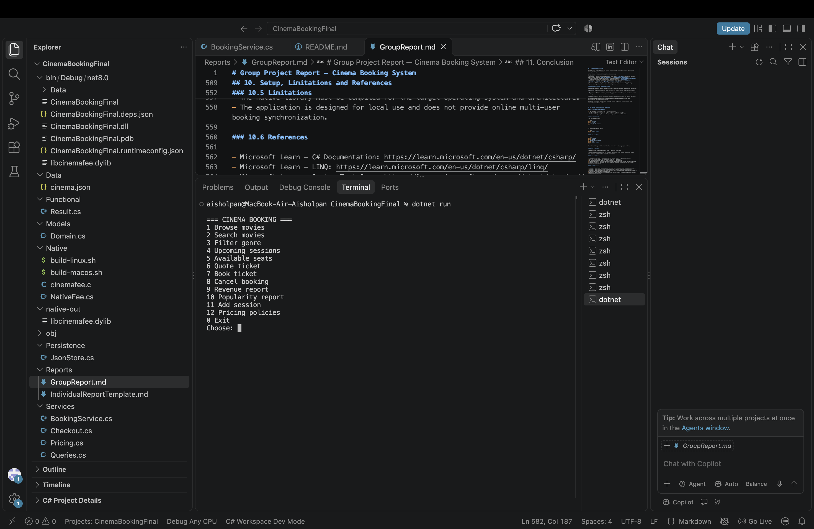
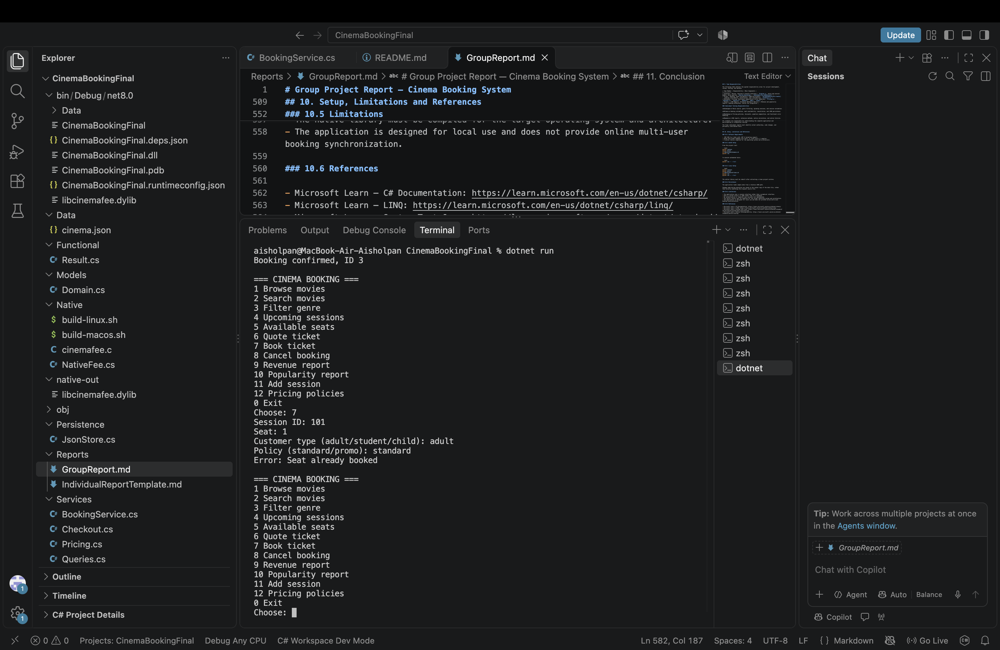
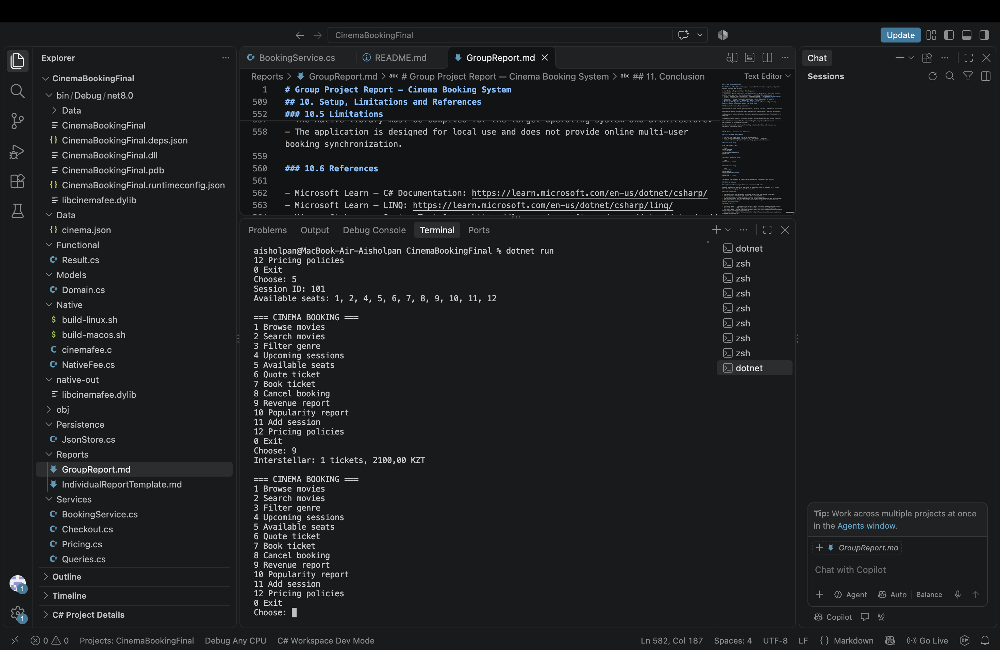
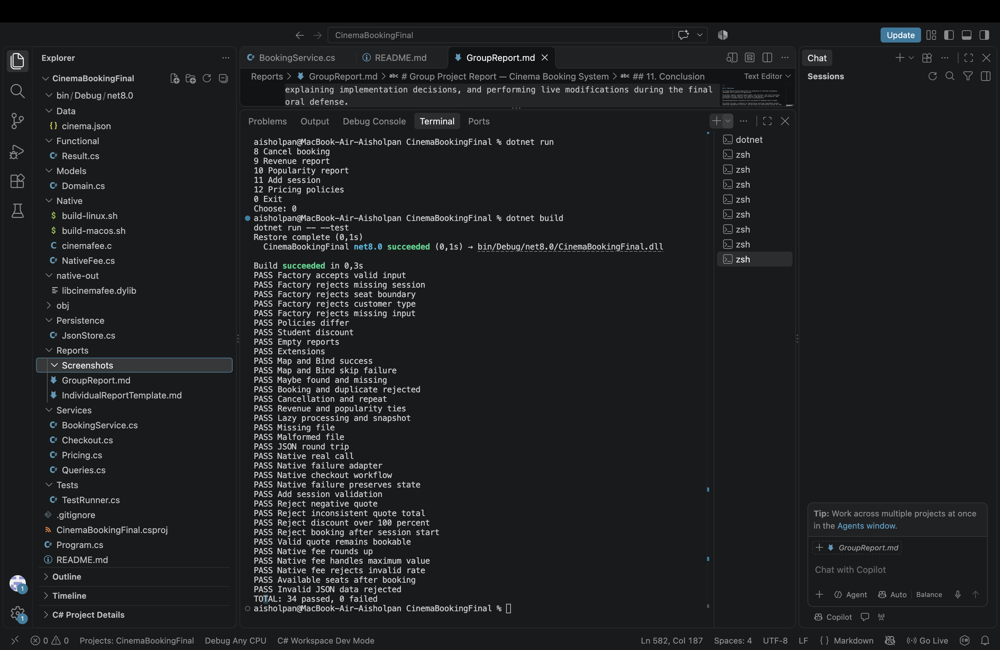

# Group Project Report — Cinema Booking System

Repository URL: https://github.com/aisholpan777/CinemaBookingFinal
Branch: main
Final Commit SHA: 2234f3aa8725e15547547ec9b0db327ca86e4eae


**Course:** Introduction to Functional Programming  
**Academic Year:** 2026–2027  
**Project:** Cinema Booking System  
**Technology:** C# / .NET 8, LINQ, JSON, Native C  
**Team Size:** 4 students

**Team Members:**
- Aisholpan — Student 1
- Dilnaz — Student 2
- Zhuldyzay — Student 3
- Zhasmin — Student 4

**Student Group(s):** [Insert actual group numbers]  
**Repository URL:** [Insert GitHub repository URL]  
**Branch:** [Insert final branch]  
**Final Commit SHA:** [Insert final commit identifier]

---

## 1. Problem, Intended Users and Goals

### 1.1 Problem Description

Cinema booking involves managing movies, scheduled sessions, seat availability, ticket prices, and customer reservations. Without proper validation, a system may allow duplicate seat reservations, invalid bookings, or incorrect ticket calculations.

The Cinema Booking System addresses these problems through a console-based application that separates business logic from input/output operations.

### 1.2 Intended Users

The application supports two user roles:

**Cinema customers** can browse movies, search by title, filter by genre, view sessions, check available seats, calculate ticket prices, and book or cancel tickets.

**Cinema staff** can add cinema sessions, inspect booking information, and view revenue and popularity reports.

These are intended user roles rather than separate authenticated accounts.

### 1.3 Project Goals

The main goals are to:

1. Implement a working cinema booking application.
2. Apply functional programming principles to business operations.
3. Use immutable domain models and explicit validation.
4. Prevent invalid booking operations.
5. Support configurable pricing policies.
6. Generate useful reports using LINQ.
7. Store application data in JSON.
8. Integrate a native C function using P/Invoke.
9. Verify application behavior through automated tests.

---

## 2. Implemented Scope and Demonstrations

The application provides 12 console menu commands and supports the following domain workflows.

| Workflow | Description | Expected Result |
|---|---|---|
| Movie browsing and search | Display movies and search by title | Matching movies |
| Genre filtering | Filter movies by genre | Movies in the selected genre |
| Upcoming sessions | Find future cinema sessions | Ordered upcoming sessions |
| Seat availability | Check available seats | Unoccupied seat numbers |
| Ticket quotation | Apply pricing policies and native fee | Final ticket quote |
| Booking confirmation | Validate and reserve a seat | Confirmed booking |
| Booking cancellation | Cancel an existing booking | Updated booking state |
| Revenue reporting | Aggregate revenue by movie | Revenue rows |
| Popularity reporting | Count confirmed tickets | Popularity ranking |
| Session management | Validate and add a session | Updated cinema schedule |

### 2.1 Pricing Demonstration

Consider a cinema session with a base ticket price of 2,500.00 KZT.

For an adult customer using the standard policy:

- Base price: 2,500.00 KZT
- Customer discount: 0%
- Promotional discount: 0%
- Native booking fee: 125.00 KZT
- Final price: 2,625.00 KZT

For an adult customer using the promotional policy:

- Base price: 2,500.00 KZT
- Promotional discount: 10%
- Discounted price: 2,250.00 KZT
- Native booking fee: 112.50 KZT
- Final price: 2,362.50 KZT

These values demonstrate the expected difference between the two policies. Actual console output should be captured from the running application.

### 2.2 Booking Demonstration

A valid booking request includes an existing session, a valid available seat, and a recognized customer type.

The system validates the request, calculates the ticket price, confirms the booking, and saves the updated state.

Attempting to reserve the same occupied seat again produces an explicit failure instead of creating a duplicate reservation.

Cancelling a confirmed booking releases the seat. Repeating the cancellation is rejected.

### 2.3 Screenshots

Insert screenshots captured from the actual application:

**Figure 1:** Main console menu  


**Figure 2:** Movie browsing or filtering


**Figure 3:** Successful ticket quotation or booking  


**Figure 4:** Expected booking validation failure  



**Figure 5:** Revenue or popularity report  



**Figure 6: Automated test execution — 34 passed, 0 failed**



---

## 3. Architecture

### 3.1 Project Structure

The application is organized into several modules.

| Module | Responsibility |
|---|---|
| `Models/Domain.cs` | Immutable domain models |
| `Functional/Result.cs` | Functional error handling |
| `Services/BookingService.cs` | Booking and session operations |
| `Services/Pricing.cs` | Pricing calculations and policies |
| `Services/Checkout.cs` | Booking workflow integration |
| `Services/Queries.cs` | Movie queries, seat availability and reports |
| `Persistence/JsonStore.cs` | JSON loading, saving and validation |
| `Native/` | Native C fee calculation and P/Invoke |
| `Tests/TestRunner.cs` | Automated test runner |
| `Program.cs` | Console interface and application coordination |

### 3.2 Domain Models

The application uses related domain models:

**Movie** represents a film available in the cinema.

**Session** represents a scheduled showing, including its movie reference, date, seat capacity, and ticket price.

**Booking** represents a customer's reservation and its status.

**CinemaState** contains the application's collections of movies, sessions, and bookings.

Additional models represent booking inputs, validated selections, pricing results, quotes, and report rows.

Immutable records and `ImmutableArray<T>` help prevent unexpected modification of application state.

### 3.3 Functional Core and Side-Effect Boundaries

The functional core contains calculations, validations, transformations, and queries.

These operations receive input values and return results without reading console input or directly modifying files.

The application's side-effect boundaries include:

- Console input and output in `Program.cs`.
- JSON file access in `JsonStore.cs`.
- Native C calls through `NativeFeeCalculator`.

This separation makes domain logic easier to test independently.

### 3.4 Application Data Flow

The booking workflow follows this sequence:

1. The user enters booking information.
2. The application validates the input.
3. A pricing policy calculates the discounted price.
4. The native C function calculates the booking fee.
5. The application constructs a quote.
6. The booking service validates and confirms the reservation.
7. The updated immutable state is saved to JSON.
8. The result is displayed to the user.

---

## 4. Assignment 5 — Functional Pipeline

The project implements a three-stage pricing pipeline.

### Stage 1 — Validation and Normalization

**Method:** `ValidatedSelection.Create()`

**Input:** `CinemaState`, `BookingInput`

**Output:** `Result<ValidatedSelection>`

This stage checks whether the requested session exists, the seat is valid and available, the customer type is recognized, and the price is valid.

Only valid requests produce a `ValidatedSelection`.

### Stage 2 — Price Calculation

**Method:** `Pricing.ApplyPolicy()`

**Input:** `ValidatedSelection`, `Func<long, long>`

**Output:** `Result<PricedSelection>`

This stage applies customer discounts and a configurable pricing policy.

### Stage 3 — Quote Construction

**Method:** `Pricing.BuildQuote()`

**Input:** `PricedSelection`, booking fee

**Output:** `Result<Quote>`

This stage constructs the final quote containing the calculated ticket amount and fee.

### Higher-Order Function

`Pricing.CurryPolicy()` creates configured discount functions.

Two configurations are used:

- `Pricing.CurryPolicy(0)`
- `Pricing.CurryPolicy(10)`

The pricing pipeline can use either policy without changing its internal structure.

This demonstrates higher-order functions, currying, partial application, and configurable business rules.

---

## 5. Assignment 6 — Safe Operation Sequence

### 5.1 Unsafe Approach

An unsafe booking implementation could directly create a booking and add it to the collection without validating the session or seat.

This could result in:

- Reservations for nonexistent sessions.
- Invalid seat numbers.
- Duplicate confirmed reservations.
- Incorrect prices.

### 5.2 Validated Factory

The application uses `ValidatedSelection.Create()` to enforce booking prerequisites.

The constructor of `ValidatedSelection` is private, preventing external code from freely creating invalid validated selections.

The factory checks the actual booking rules and returns either a valid selection or an explicit failure.

### 5.3 Booking Status Cases

The system represents two booking statuses:

- `BookingStatus.Confirmed`
- `BookingStatus.Cancelled`

Pattern matching is used in booking operations to handle these cases.

### 5.4 Safe Transitions

`BookingService.Confirm()` validates confirmation requirements.

`BookingService.Cancel()` rejects invalid cancellation attempts, including repeated cancellation.

Failed operations return a failure without modifying the original immutable state.

This makes the required operation sequence explicit and prevents invalid transitions.

---

## 6. Assignment 7 — Explicit Outcomes

### 6.1 Result Type

The application uses `Result<T>` to represent success or failure.

A successful operation returns `Ok(value)`.

A failed operation returns `Fail(error)`.

This approach avoids using exceptions for ordinary business validation failures.

### 6.2 Maybe Type

`Maybe<T>` represents the presence or absence of a value.

The application uses it for lookup operations, including booking lookup.

### 6.3 Map and Bind

`Map()` transforms a successful result using a function.

`Bind()` connects dependent operations that can themselves fail.

When an operation fails, subsequent dependent transformations are skipped.

The pricing workflow uses these concepts to compose validation and calculation.

### 6.4 Domain Failure Examples

| Failure | Expected Behavior |
|---|---|
| Missing session | Return a meaningful failure |
| Occupied seat | Reject duplicate booking |
| Invalid customer type | Reject ticket calculation |
| Repeated cancellation | Reject invalid state transition |
| Invalid ticket price | Return validation failure |

### 6.5 File Boundary Errors

`JsonStore.Load()` handles file-related failures, including:

- Missing files.
- Malformed JSON.
- Invalid persisted domain data.

Operational exceptions are handled at the file boundary and converted into explicit failure results.

---

## 7. Assignment 8 — Queries and Native Integration

### 7.1 Custom Extension Methods

The project implements two reusable extension methods:

**`BookingExtensions.Active()`**

Filters bookings to include active confirmed reservations.

**`BookingExtensions.ForSession()`**

Filters bookings by a specified session identifier.

These methods are used in application queries.

### 7.2 Revenue Report

`Queries.Revenue()`:

1. Selects confirmed bookings.
2. Joins booking information with sessions and movies.
3. Groups bookings by movie.
4. Counts confirmed tickets.
5. Calculates total revenue.
6. Orders results by revenue with deterministic tie-breaking.

The report excludes cancelled bookings.

### 7.3 Popularity Report

`Queries.Popularity()`:

1. Selects confirmed bookings.
2. Joins bookings with movie information.
3. Groups results by movie.
4. Counts confirmed tickets.
5. Orders movies by ticket count with deterministic tie-breaking.

### 7.4 Currying and Partial Application

`Pricing.CurryPolicy()` returns a pricing function after receiving a discount configuration.

Partial application creates reusable standard and promotional policies.

The same pricing workflow accepts both configurations.

### 7.5 Lazy Evaluation

`Queries.Upcoming()` uses `yield return`.

Creating the enumerable does not immediately execute the iterator body.

Enumeration triggers processing.

The console interface uses `ToArray()` to materialize results when a stable snapshot is needed.

### 7.6 Resource Lifetime

`JsonStore.Load()` and `JsonStore.Save()` manage file streams using `using`.

Resources are disposed when the operations finish.

This prevents file handles from remaining unnecessarily open.

### 7.7 Native C Integration

The project includes a C function:

```c
int64_t cinema_fee(int64_t price_cents, int32_t rate_basis_points);
```

The function calculates a booking fee using integer arithmetic.

Valid inputs are nonnegative prices and fee rates from 0 to 10000 basis points.

Invalid inputs or arithmetic overflow return `-1`.

The native library is called from C# using P/Invoke.

`NativeFeeCalculator` validates inputs and translates native failures into explicit Result failures.

The application uses the real native calculation during ticket quotation and booking.

---

## 8. Automated Testing

### 8.1 Testing Approach

The project uses a deterministic automated test runner implemented in `Tests/TestRunner.cs`.

Tests verify successful operations, expected failures, boundary conditions, and integration behavior.

### 8.2 Test Coverage

| Test Area | Expected Behavior | Observed Result |
|---|---|---|
| Domain validation | Accept valid input, reject invalid input | Passed |
| Pricing policies | Produce correct standard and promo results | Passed |
| Functional error handling | Propagate failures without running later operations | Passed |
| Booking confirmation | Confirm valid booking and reject duplicates | Passed |
| Cancellation | Cancel confirmed booking and reject repeated cancellation | Passed |
| Session validation | Reject invalid sessions | Passed |
| Seat availability | Correctly reflect occupied seats | Passed |
| LINQ reports | Produce deterministic report results | Passed |
| Lazy evaluation | Demonstrate deferred execution and snapshots | Passed |
| Missing JSON file | Return explicit failure | Passed |
| Malformed JSON | Return explicit failure | Passed |
| JSON round trip | Preserve valid persisted state | Passed |
| Native C calculation | Produce correct fee values | Passed |
| Native failure handling | Return explicit failure | Passed |
| Native checkout | Integrate fee calculation with quotation and booking | Passed |

### 8.3 Latest Local Execution

The application was built and tested on macOS.

```text
Build succeeded.
TOTAL: 34 passed, 0 failed
```

All 34 automated tests passed in the observed local execution.

The console application also launched successfully and displayed its 12 menu options.

### 8.4 Defects and Improvements

During project review, several areas were improved:

- Stronger input and domain validation.
- More explicit failure handling.
- Additional boundary tests.
- Improved JSON validation.
- Native fee arithmetic for large integer values.
- Console input handling.
- Additional tests for native rounding, invalid rates, seat availability, and invalid persisted data.

These changes were incorporated into the tested version.

The individual reports should identify which team member actually performed each change rather than attributing shared review work to an arbitrary student.

---

## 9. Team Responsibilities

The following table defines the agreed responsibility areas for project development, review, testing, and defense.

| Team Member | Responsibility | Main Components |
|---|---|---|
| Aisholpan | Movies, Sessions & Console Interface | `Program.cs`, movie and session models, movie queries, `Queries.Upcoming()`, `BookingService.AddSession()` |
| Dilnaz | Booking, State Validation & JSON Persistence | `ValidatedSelection.Create()`, booking confirmation, cancellation, seat availability, `JsonStore.cs` |
| Zhuldyzay | Pricing, Functional Composition & Error Handling | `Pricing.cs`, `Checkout.cs`, `Result<T>`, `Maybe<T>`, `Map()`, `Bind()` |
| Zhasmin | LINQ Reports, Extension Methods & Native C | Revenue and popularity reports, booking extensions, native fee integration |

### Individual Testing Responsibilities

**Aisholpan:** Movie search, genre filtering, upcoming sessions, and session validation.

**Dilnaz:** Booking validation, seat availability, cancellation, and JSON persistence.

**Zhuldyzay:** Pricing policies, discounts, pipeline composition, and functional error handling.

**Zhasmin:** LINQ reports, extension methods, native calculation, and native failures.

All students are responsible for understanding the complete application and participating in integration testing.

The final individual reports must identify actual authorship, code changes, and personally contributed tests.

---

## 10. Setup, Limitations and References

### 10.1 Software Requirements

- .NET SDK 8 or later with .NET 8 targeting support.
- macOS with Xcode Command Line Tools, or Linux with a C compiler.
- A native library compiled for the operating system and architecture.

### 10.2 macOS Setup

From the project root:

```bash
dotnet restore
dotnet build
sh Native/build-macos.sh
dotnet run
```

To execute automated tests:

```bash
dotnet run -- --test
```

### 10.3 Linux Setup

```bash
dotnet restore
dotnet build
sh Native/build-linux.sh
dotnet run
dotnet run -- --test
```

The native library must be rebuilt after extracting a clean project archive.

### 10.4 Persistence

The application loads sample data from a relative JSON path.

Changes made during execution are saved to the output copy of the data file, rather than directly modifying the original source file.

### 10.5 Limitations

- The application uses a console interface rather than a graphical interface.
- Data is stored locally in JSON rather than in a database.
- No authentication or separate user accounts are implemented.
- The native library must be compiled for the target operating system and architecture.
- The application is designed for local use and does not provide online multi-user booking synchronization.

### 10.6 References

- Microsoft Learn — C# Documentation: https://learn.microsoft.com/en-us/dotnet/csharp/
- Microsoft Learn — LINQ: https://learn.microsoft.com/en-us/dotnet/csharp/linq/
- Microsoft Learn — System.Text.Json: https://learn.microsoft.com/en-us/dotnet/standard/serialization/system-text-json/overview
- Microsoft Learn — Native Interoperability: https://learn.microsoft.com/en-us/dotnet/standard/native-interop/
- Course materials — Introduction to Functional Programming, Assignments 5–8 and Final Project Requirements.

### 10.7 AI Assistance

[Describe the AI tools actually used, the tasks they supported, how the team reviewed and tested generated suggestions, and any acknowledgement required by the instructor. Confirm that this use complies with course policy.]

---

## 11. Conclusion

The Cinema Booking System demonstrates the integration of functional programming techniques into a practical C# application.

The project combines immutable domain models, pure functions, safe state transitions, configurable pricing, explicit error handling, LINQ queries, lazy evaluation, JSON persistence, automated testing, and native C interoperability.

The tested application successfully built and passed 34 automated tests on macOS.

The project provides a foundation for demonstrating functional programming concepts, explaining implementation decisions, and performing live modifications during the final oral defense.